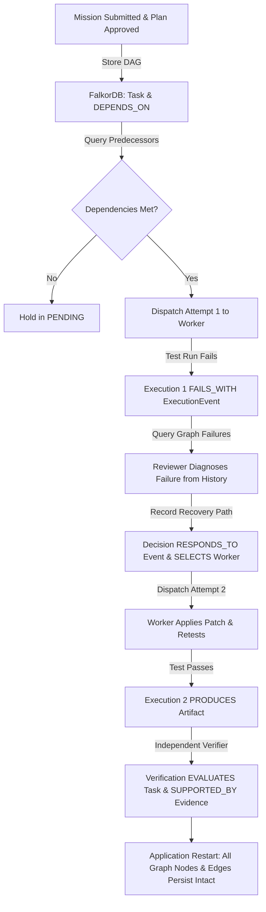

# FalkorDB Integration: Graph Memory & Coordination Layer

## 1. Executive Summary

In the **AI Work Supervisor** architecture, **FalkorDB** serves as the authoritative **Graph Memory and Coordination Layer**.

Rather than treating FalkorDB as a decorative database or an auxiliary visualization cache, FalkorDB is placed at the center of the supervisory nervous system. It stores task dependencies, multi-attempt execution histories, causal failure chains, handoff context transfers, supervisory recovery decisions, and independent verification evidence.

---

## 2. Persistence Boundaries: SQLite vs. FalkorDB

To preserve local-first reliability and avoid distributed transaction hazards, data ownership is clearly delineated:

| Subsystem / Data Domain | Authoritative Store | Rationale |
| :--- | :--- | :--- |
| **Mission Records & Objectives** | SQLite (CRUD) + **FalkorDB (Graph)** | SQLite stores operational state; FalkorDB anchors the requirement graph. |
| **Task Dependencies & DAG** | **FalkorDB (Graph)** | Dependency resolution, cycle detection, and readiness traversals. |
| **Execution Attempts & Retries** | **FalkorDB (Graph)** | Models distinct attempts (`Execution` nodes) rather than overwriting prior attempts. |
| **Causal Failure Chains** | **FalkorDB (Graph)** | Links failed attempts to specific execution events with `FAILS_WITH`. |
| **Supervisory Recovery Decisions**| **FalkorDB (Graph)** | Traced via `RESPONDS_TO` (ExecutionEvent) and `SELECTS` (Agent). |
| **Handoff Provenance & Context** | **FalkorDB (Graph)** | Direct context transfer graph (`Handoff TRANSFERS_CONTEXT Task`). |
| **Independent Verification Evidence**| **FalkorDB (Graph)** | Proof lineage: `Verification EVALUATES Task` and `SUPPORTED_BY Evidence`. |
| **Transactional Audit Log & Sync** | SQLite | High-frequency write-ahead logging and multi-device sync outbox. |

> **Fail-Safe Invariant**: When FalkorDB is unavailable, graph-dependent coordination endpoints and retrieval flows explicitly return HTTP 503 or raise `FalkorDBUnavailableError`. The system **never** creates silent fallbacks that pretend graph-dependent decisions succeeded.

---

## 3. Property Graph Model

### Nodes

- **`(:Mission)`**: `{id, title, goal, repository_path, status, created_at, updated_at}`
- **`(:Requirement)`**: `{id, mission_id, description, category, created_at}`
- **`(:Task)`**: `{id, mission_id, title, order, status, expected_files, created_at, updated_at}`
- **`(:Agent)`**: `{id, agent_type, model, display_name, status, created_at, updated_at}`
- **`(:Execution)`**: `{id, task_id, mission_id, agent_id, attempt_number, status, started_at, completed_at, error_signature, summary}`
- **`(:ExecutionEvent)`**: `{id, execution_id, event_type, severity, payload_json, timestamp}`
- **`(:Decision)`**: `{id, mission_id, task_id, decision_type, action, reason, timestamp}`
- **`(:Handoff)`**: `{id, task_id, source_agent, target_agent, trigger, status, context_summary, timestamp}`
- **`(:Artifact)`**: `{id, file_path, artifact_type, hash, created_at}`
- **`(:Evidence)`**: `{id, evidence_type, description, passed, empirical_data, created_at}`
- **`(:Verification)`**: `{id, task_id, mission_id, decision, summary, verified_at}`

### Relationships

- `(:Mission)-[:HAS_REQUIREMENT]->(:Requirement)`
- `(:Mission)-[:CONTAINS_TASK]->(:Task)`
- `(:Task)-[:DEPENDS_ON]->(:Task)`
- `(:Agent)-[:EXECUTES]->(:Execution)`
- `(:Execution)-[:FOR_TASK]->(:Task)`
- `(:Execution)-[:EMITS]->(:ExecutionEvent)`
- `(:Execution)-[:PRODUCES]->(:Artifact)`
- `(:Execution)-[:FAILS_WITH]->(:ExecutionEvent)`
- `(:Decision)-[:RESPONDS_TO]->(:ExecutionEvent)`
- `(:Decision)-[:SELECTS]->(:Agent)`
- `(:Handoff)-[:TRANSFERS_CONTEXT]->(:Task)`
- `(:Verification)-[:EVALUATES]->(:Task)`
- `(:Verification)-[:SUPPORTED_BY]->(:Evidence)`

---

## 4. Key Cypher Queries & Operational Significance

### 1. Task Coordination & Dependency Readiness Traversal
```cypher
MATCH (t:Task {id: $task_id})-[:DEPENDS_ON]->(dep:Task)
RETURN dep.id AS id, dep.title AS title, dep.status AS status, dep.order AS order
ORDER BY dep.order ASC
```
*Why it matters*: Prior to dispatching a task, the Supervisor inspects all predecessor tasks. If any dependency is not `COMPLETED` or `VERIFIED`, dispatch is blocked.

### 2. Prior Failure History Retrieval for Informed Recovery
```cypher
MATCH (e:Execution {task_id: $task_id, status: 'FAILED'})
OPTIONAL MATCH (e)-[:FAILS_WITH]->(evt:ExecutionEvent)
OPTIONAL MATCH (d:Decision)-[:RESPONDS_TO]->(evt)
RETURN e.id, e.attempt_number, e.agent_id, e.error_signature, evt.id, evt.event_type, d.id, d.action, d.reason
ORDER BY e.attempt_number ASC
```
*Why it matters*: When an agent loops or fails tests, the Supervisor queries FalkorDB to assemble a historical failure dossier. This prevents naive retries of identical rejected code paths.

### 3. Supervisory Decision Lineage
```cypher
MATCH (d:Decision {mission_id: $mission_id})
OPTIONAL MATCH (d)-[:RESPONDS_TO]->(evt:ExecutionEvent)
OPTIONAL MATCH (d)-[:SELECTS]->(a:Agent)
RETURN d.id, d.task_id, d.decision_type, d.action, d.reason, d.timestamp, evt.id, evt.event_type, a.id, a.display_name
ORDER BY d.timestamp ASC
```
*Why it matters*: Guarantees complete auditability for why an intervention, model swap, or patch was executed. Every decision references its causal trigger and chosen actor.

### 4. Independent Verification Evidence Traceability
```cypher
MATCH (v:Verification {task_id: $task_id})-[:EVALUATES]->(t:Task)
OPTIONAL MATCH (v)-[:SUPPORTED_BY]->(ev:Evidence)
RETURN v.id, v.decision, v.summary, v.verified_at, t.id, t.title,
       collect({type: ev.evidence_type, description: ev.description, passed: ev.passed}) AS evidence
```
*Why it matters*: Enforces the core product invariant: **Claimed Complete != Verified Complete**. Verification outcomes are provably linked to empirical test outputs and git diff assertions.

---

## 5. Real Execution Workflow

The real execution lifecycle follows these verified stages:



---

## 6. Setup, Configuration & Running Tests

### Environment Configuration (`.env`)
```bash
FALKORDB_HOST=localhost
FALKORDB_PORT=6379
FALKORDB_PASSWORD=
FALKORDB_GRAPH=ai_supervisor_memory
FALKORDB_TIMEOUT=10.0
FALKORDB_SSL=false
```

### Starting FalkorDB via Docker Compose
```bash
docker compose up -d
```

### Running the FalkorDB Integration Test Suite
```bash
python -m pytest tests/test_falkordb_graph_memory.py -v
```

### Running the Full End-to-End Real Mission Demonstration
```bash
python demo_falkordb_workflow.py
```

---

## 7. Known Limitations & Unimplemented Capabilities

1. **Distributed Graph Transactions**: SQLite and FalkorDB dual-writes are currently coordinated via application-level eventual consistency and event streaming; two-phase commit is not implemented.
2. **Dynamic Cypher Query Builder UI**: Graph inspection endpoints (`/api/missions/{id}/graph`) return raw nodes and edges for visualization, but interactive Cypher query consoles are not yet embedded in the web dashboard.
3. **Graph Partitioning**: Single graph per project namespace (`ai_supervisor_memory`); multi-tenant cross-cluster sharding is deferred to production scale.

---

## 8. AI Assistance Transparency

AI assistance (via Antigravity / Gemini 3.8 Flash) was utilized for:
- Reverse-engineering repository persistence interfaces.
- Synthesizing Cypher schema constraints and parameterized query helpers.
- Writing automated integration test fixtures verifying graph invariants across restarts.
- Diagnosing WSL2 Docker engine socket bindings on the host operating system.
